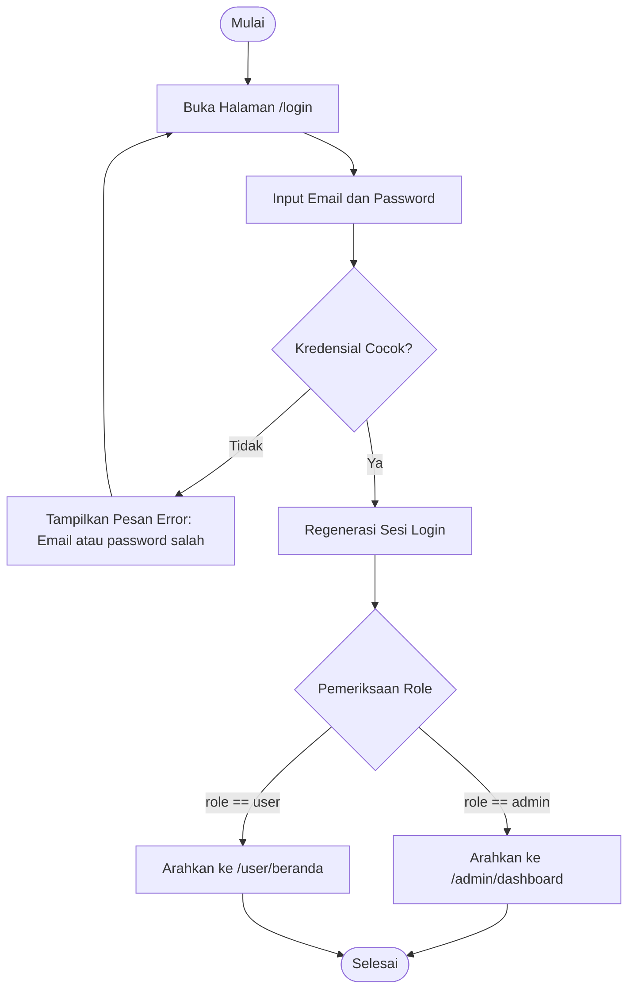
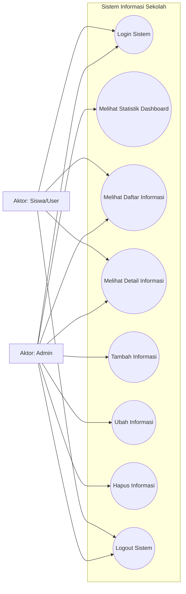
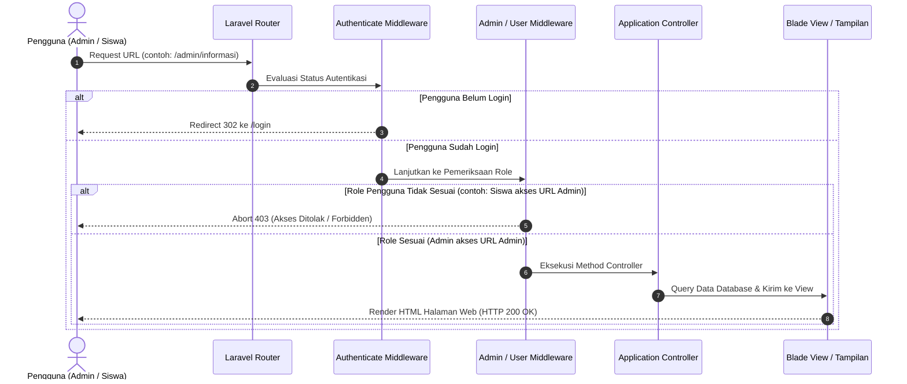
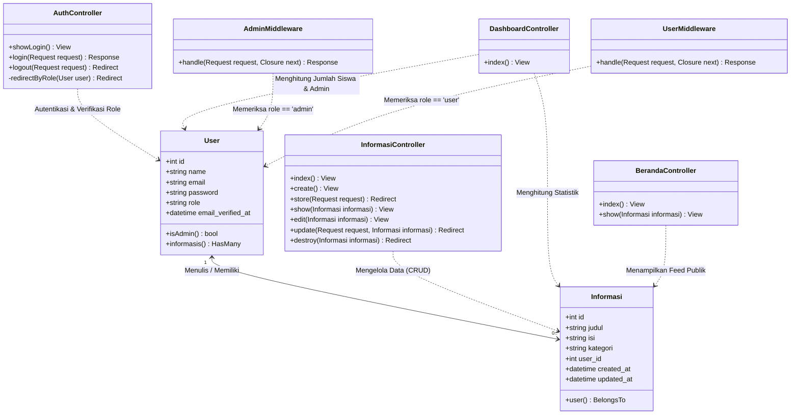
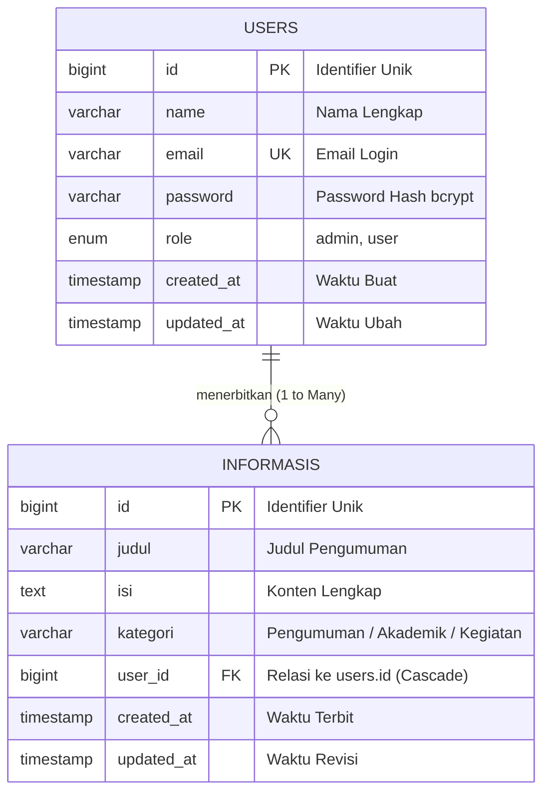

# DOKUMEN ANALISIS KEBUTUHAN
### Project Praktik — Sistem Informasi Berbasis Web (Sekolah)

* **Nama** : [Isi Nama Anda]
* **Kelas** : [Isi Kelas Anda, contoh: XII RPL 1]
* **No. Absen** : [Isi Nomor Absen]
* **Tanggal** : [Isi Tanggal Hari Ini, contoh: 15 Oktober 2026]

---

## 1. ANALISIS KEBUTUHAN SISTEM

### 1.1 Deskripsi Umum Sistem
Website Portal Informasi Sekolah adalah aplikasi berbasis web yang dibangun menggunakan arsitektur **Model-View-Controller (MVC)** dengan framework **Laravel 11** dan database **MySQL / MariaDB**. 

Sistem ini dirancang untuk memusatkan dan mempermudah penyampaian informasi resmi sekolah (pengumuman akademik, kegiatan kesiswaan, PPDB, ekstrakurikuler) kepada siswa secara terstruktur dan terpadu. 

Sistem menerapkan mekanisme **Single Entry Authentication (Satu Pintu Login)** melalui halaman `/login` untuk seluruh pengguna. Setelah kredensial diverifikasi, sistem secara otomatis mengidentifikasi hak akses (*Role-Based Access Control*) dan mengarahkan pengguna ke halaman yang relevan:
* Pengguna dengan peran **Admin** diarahkan ke **Dashboard Admin** (`/admin/dashboard`) untuk memantau ringkasan statistik dan melakukan manajemen penuh (CRUD) terhadap seluruh informasi sekolah.
* Pengguna dengan peran **User (Siswa)** diarahkan ke **Halaman Beranda Siswa** (`/user/beranda`) untuk melihat katalog pengumuman terbaru dan membaca rincian artikel tanpa hak akses modifikasi data. Sistem dilindungi oleh *middleware* khusus yang secara ketat menolak akses siswa ke halaman admin (HTTP 403 Forbidden).

---

### 1.2 Identifikasi Aktor

#### 1. Aktor: Admin (Pengelola / Staf Tata Usaha / Guru)
* Melakukan login melalui halaman login tunggal dan diverifikasi sebagai akun ber-role `admin`.
* Diarahkan secara otomatis menuju **Dashboard Admin**.
* Melihat ringkasan data statistik eksekutif: jumlah total informasi yang terbit, total user siswa terdaftar, total akun admin, dan daftar 5 informasi terbaru.
* Melakukan operasi **CRUD (Create, Read, Update, Delete)** data informasi:
  * **Create**: Menambah pengumuman baru (judul, kategori, isi) dengan validasi form server-side.
  * **Read**: Melihat daftar tabel informasi dengan paginasi, rincian tanggal, dan penulis.
  * **Update**: Memperbarui judul, kategori, atau isi pengumuman yang sudah ada.
  * **Delete**: Menghapus pengumuman yang kedaluwarsa atau tidak diperlukan lagi.
* Melakukan logout untuk mengakhiri sesi autentikasi secara aman.

#### 2. Aktor: User (Siswa / Peserta Didik)
* Melakukan login melalui halaman login tunggal dan diverifikasi sebagai akun ber-role `user`.
* Diarahkan secara otomatis menuju **Portal Beranda Siswa**.
* Melihat daftar informasi dan pengumuman aktif sekolah yang disusun dalam format *card grid* interaktif.
* Membuka dan membaca halaman detail informasi yang memuat judul lengkap, tanggal terbit, nama staf penerbit, isi pengumuman penuh, serta daftar rekomendasi pengumuman terkait.
* **Pembatasan Hak Akses**: Siswa tidak memiliki izin untuk menambah, mengedit, atau menghapus informasi apa pun.
* **Proteksi Keamanan**: Siswa diblokir (*Akses Ditolak - 403 Forbidden*) jika mencoba mengakses URL khusus admin seperti `/admin/dashboard` maupun `/admin/informasi`.
* Melakukan logout untuk mengakhiri sesi.

---

### 1.3 Identifikasi Proses Sistem

| No | Nama Proses | Aktor Terkait | Keterangan & Alur Logika |
|:---:|:---|:---|:---|
| **1** | **Autentikasi (Login)** | Admin & User (Siswa) | Pengguna memasukkan email dan password. Sistem memvalidasi kelengkapan format, mencocokkan hash password bcrypt di database, meregenerasi session token, lalu melakukan *conditional redirection* sesuai nilai kolom `role`. |
| **2** | **Monitoring Dashboard** | Admin | Controller menghitung agregasi data menggunakan Eloquent (`count()`) untuk total informasi, total siswa, total admin, serta memuat 5 rekaman informasi teranyar. |
| **3** | **Tambah Informasi (Create)** | Admin | Admin mengisi formulir input judul, memilih kategori (Pengumuman, Akademik, Kegiatan), dan menulis isi teks. Data divalidasi oleh sistem dan disimpan dengan menyematkan `user_id` dari admin yang sedang login. |
| **4** | **Lihat Daftar Informasi (Read)** | Admin & User (Siswa) | **Admin**: Melihat seluruh data dalam bentuk tabel manajemen data dilengkapi pagination dan tombol aksi.<br>**User**: Melihat data dalam bentuk katalog kartu informasi yang responsif dan mudah dibaca. |
| **5** | **Lihat Detail Informasi (Show)** | Admin & User (Siswa) | Menampilkan satu rekaman data pengumuman secara utuh berdasarkan ID atau model binding, termasuk informasi tanggal publikasi dan penulis. |
| **6** | **Ubah Informasi (Update)** | Admin | Admin membuka formulir edit yang terisi data lama, mengubah data yang diperlukan, divalidasi sistem, lalu disimpan kembali ke database. |
| **7** | **Hapus Informasi (Delete)** | Admin | Admin memilih data yang ingin dihapus. Setelah konfirmasi, sistem menghapus rekaman data dari tabel `informasis`. Data yang dihapus seketika hilang dari beranda siswa. |
| **8** | **Proteksi Otorisasi (Middleware)** | Sistem (Otomatis) | `AdminMiddleware` memastikan `auth()->user()->role === 'admin'`. Jika siswa mencoba mengakses halaman admin, sistem langsung menghentikan request dengan respons HTTP 403. |
| **9** | **Terminasi Sesi (Logout)** | Admin & User (Siswa) | Mengosongkan sesi autentikasi, melakukan invalidasi session, meregenerasi CSRF token, dan mengembalikan pengguna ke halaman `/login`. |

---

## 2. FLOWCHART SISTEM

### 2.1 Flowchart 1: Alur Login & Pengecekan Role Pengguna
*Alur ini menjelaskan proses masuknya pengguna ke sistem, validasi kredensial, dan pengalihan dinamis ke dashboard admin atau beranda siswa.*

```
                 [ MULAI ]
                     │
                     ▼
           [ Buka URL: /login ]
                     │
                     ▼
       [ Input Email & Password ]
                     │
                     ▼
            / Kredensial Valid? \
           /   (Email & Hash     \─── TIDAK ──► [ Munculkan Pesan Error ]
           \     Password Cocok) /                     │
            \                   /                      ▼
                     │ YA                       [ Kembali ke Form ]
                     ▼
           [ Regenerasi Session ]
                     │
                     ▼
               / Cek Nilai \
              /    Role     \
             /   Pengguna?   \
             \               /
              \             /
               /           \
     role == 'admin'   role == 'user'
             /               \
            ▼                 ▼
   [ Redirect ke:      [ Redirect ke:
   /admin/dashboard ]   /user/beranda ]
            │                 │
            └────────┬────────┘
                     │
                     ▼
                 [ SELESAI ]
```

*(Versi Diagram Mermaid untuk diekspor ke gambar jika diperlukan):*


---

### 2.2 Flowchart 2: Alur CRUD Informasi oleh Admin
*Alur ini menggambarkan bagaimana Admin mengelola data pengumuman sekolah mulai dari Create, Read, Update, hingga Delete.*

```
                 [ MASUK DASHBOARD ADMIN ]
                             │
                             ▼
             [ Pilih Menu: Kelola Informasi ]
                             │
                             ▼
          [ Tampilkan Tabel Informasi (Read List) ]
                             │
        ┌────────────────────┼────────────────────┐
        │                    │                    │
        ▼                    ▼                    ▼
[ Klik + Tambah ]    [ Klik Tombol Edit ]  [ Klik Tombol Hapus ]
        │                    │                    │
        ▼                    ▼                    ▼
 [ Buka Form Input ]  [ Buka Form Ubah ]   [ Dialog Konfirmasi ]
        │                    │                    │
        ▼                    ▼             / Yakin Hapus? \
[ Isi Judul, Kategori, [ Ubah Konten ]     /                \── TIDAK ──┐
       dan Teks ]            │             \                /           │
        │                    │              \              /            │
        ▼                    ▼                    │ YA                  │
   / Validasi? \        / Validasi? \             ▼                     │
  /  (Server)   \      /  (Server)   \     [ Hapus Data dari DB ]       │
  \             /      \             /            │                     │
   \           /        \           /             │                     │
    │ YA    │ TDK        │ YA    │ TDK            │                     │
    │       └──────┐     │       └──────┐         │                     │
    ▼              ▼     ▼              ▼         ▼                     │
[ Simpan ke DB ] [Error] [Update DB] [Error]  [ Notifikasi Sukses ]     │
    │              │     │              │         │                     │
    └──────────────┴─────┴──────────────┴─────────┴─────────────────────┘
                             │
                             ▼
              [ Refresh Halaman Tabel Informasi ]
                             │
                             ▼
                         [ SELESAI ]
```

---

## 3. UML DIAGRAM

### 3.1 Use Case Diagram
Diagram ini memetakan batasan sistem, aktor yang terlibat, dan fungsionalitas yang dapat diakses oleh masing-masing peran.

```
       +--------------------------------------------------------------+
       |             SISTEM INFORMASI SEKOLAH (PORTAL)                |
       |                                                              |
       |      +------------------------------------------------+      |
       |      |                  (1. Login)                    |      |
       |      +------------------------------------------------+      |
       |        ^                                            ^        |
       |        |                                            |        |
       |      +------------------------------------------------+      |
       |      |                  (2. Logout)                   |      |
       |      +------------------------------------------------+      |
       |        ^                                            ^        |
       |        |                                            |        |
       |      +------------------------------------------------+      |
       |      |         (3. Melihat Daftar Informasi)          |      |
       |      +------------------------------------------------+      |
       |        ^                                            ^        |
       |        |                                            |        |
       |      +------------------------------------------------+      |
       |      |          (4. Melihat Detail Informasi)         |      |
       |      +------------------------------------------------+      |
       |        ^                                                     |
       |        |                                                     |
       |      +------------------------------------------------+      |
       |      |        (5. Melihat Statistik Dashboard)        |      |
       |      +------------------------------------------------+      |
       |        ^                                                     |
       |        |                                                     |
       |      +------------------------------------------------+      |
       |      |          (6. Tambah Informasi Baru)            |      |
       |      +------------------------------------------------+      |
       |        ^                                                     |
       |        |                                                     |
       |      +------------------------------------------------+      |
       |      |             (7. Ubah Informasi)                |      |
       |      +------------------------------------------------+      |
       |        ^                                                     |
       |        |                                                     |
       |      +------------------------------------------------+      |
       |      |             (8. Hapus Informasi)               |      |
       |      +------------------------------------------------+      |
       |                                                              |
       +--------------------------------------------------------------+
            ^                                                ^
            │                                                │
       [  ADMIN  ]                                      [  SISWA  ]
```

*(Versi Diagram Mermaid):*


---

### 3.2 Activity Diagram: Alur Autentikasi & Proteksi Akses (Middleware)



---

### 3.3 Class Diagram (Model, Controller, dan Middleware)



---

## 4. RANCANGAN STRUKTUR DATABASE

### 4.1 Relasi Antar Tabel (Entity Relationship Diagram - ERD)

```
+------------------------------------+          +------------------------------------+
|               USERS                |          |             INFORMASIS             |
+------------------------------------+          +------------------------------------+
| PK | id                 (BIGINT)   |<────┐    | PK | id                 (BIGINT)   |
|    | name               (VARCHAR)  |     │    |    | judul              (VARCHAR)  |
| U  | email              (VARCHAR)  |     │    |    | isi                (TEXT)     |
|    | password           (VARCHAR)  |     │    |    | kategori           (VARCHAR)  |
|    | role               (ENUM)     |     └───┼| FK | user_id            (BIGINT)   |
|    | remember_token     (VARCHAR)  |          |    | created_at         (TIMESTAMP)|
|    | created_at         (TIMESTAMP)|          |    | updated_at         (TIMESTAMP)|
|    | updated_at         (TIMESTAMP)|          +------------------------------------+
+------------------------------------+
                  1 (Satu Admin)        relasi: HasMany        N (Banyak Informasi)
```

*(Versi Mermaid ERD):*


---

### 4.2 Kamus Data (Data Dictionary)

#### Tabel 1: `users`
Tabel ini digunakan untuk menyimpan akun kredensial seluruh pengguna sistem baik admin sekolah maupun siswa.

| No | Nama Kolom | Tipe Data | Panjang | Nullable | Key | Keterangan |
|:---:|:---|:---|:---:|:---:|:---:|:---|
| 1 | `id` | BIGINT UNSIGNED | 20 | NO | **PK** (Auto Increment) | Identifier unik setiap akun pengguna. |
| 2 | `name` | VARCHAR | 255 | NO | - | Nama lengkap admin atau siswa. |
| 3 | `email` | VARCHAR | 255 | NO | **UNIQUE** | Alamat surel unik untuk autentikasi login. |
| 4 | `email_verified_at` | TIMESTAMP | - | YES | - | Penanda verifikasi alamat email. |
| 5 | `password` | VARCHAR | 255 | NO | - | Hash bcrypt dari kata sandi akun pengguna. |
| 6 | `role` | ENUM('admin','user') | - | NO | - | Penentu level hak akses sistem (default: 'user'). |
| 7 | `remember_token` | VARCHAR | 100 | YES | - | Token *Remember Me* untuk sesi tersimpan. |
| 8 | `created_at` | TIMESTAMP | - | YES | - | Waktu data akun dibuat. |
| 9 | `updated_at` | TIMESTAMP | - | YES | - | Waktu data akun terakhir diperbarui. |

#### Tabel 2: `informasis`
Tabel ini digunakan untuk menyimpan seluruh artikel, pengumuman, dan informasi sekolah yang dibuat oleh admin.

| No | Nama Kolom | Tipe Data | Panjang | Nullable | Key | Keterangan |
|:---:|:---|:---|:---:|:---:|:---:|:---|
| 1 | `id` | BIGINT UNSIGNED | 20 | NO | **PK** (Auto Increment) | Identifier unik untuk setiap rekaman informasi. |
| 2 | `judul` | VARCHAR | 255 | NO | - | Judul utama pengumuman atau kegiatan sekolah. |
| 3 | `isi` | TEXT | - | NO | - | Teks lengkap dari isi berita atau pengumuman. |
| 4 | `kategori` | VARCHAR | 100 | NO | - | Kategori pengumuman (Pengumuman, Akademik, Kegiatan). |
| 5 | `user_id` | BIGINT UNSIGNED | 20 | NO | **FK** | Terhubung ke `users.id` dengan aturan `ON DELETE CASCADE`. |
| 6 | `created_at` | TIMESTAMP | - | YES | - | Tanggal dan waktu publikasi pengumuman. |
| 7 | `updated_at` | TIMESTAMP | - | YES | - | Tanggal dan waktu pengumuman terakhir diedit. |

---

## 5. RANCANGAN UI (WIREFRAME / MOCKUP)

### 5.1 Halaman Login (`/login`)
Desain satu pintu gerbang masuk dengan tata letak kartu di tengah layar (*centered card*), latar belakang bertema gelap modern (*dark theme*), dan petunjuk akun demo pengujian.

```
+-------------------------------------------------------------------------------+
|                                                                               |
|                      +---------------------------------+                      |
|                      |      [ ICON BUKU / SEKOLAH ]    |                      |
|                      |          Selamat Datang         |                      |
|                      |  Website Informasi Sekolah      |                      |
|                      |                                 |                      |
|                      |  Email                          |                      |
|                      |  [ admin@sekolah.com          ] |                      |
|                      |                                 |                      |
|                      |  Password                       |                      |
|                      |  [ •••••••••••••              ] |                      |
|                      |                                 |                      |
|                      |  [      MASUK SEKARANG        ] |                      |
|                      |                                 |                      |
|                      |  Akun Demo Pengujian:           |                      |
|                      |  * Admin: admin@sekolah.com     |                      |
|                      |  * Siswa: siswa@sekolah.com     |                      |
|                      |  * Sandi: password123           |                      |
|                      +---------------------------------+                      |
|                                                                               |
+-------------------------------------------------------------------------------+
```

---

### 5.2 Dashboard Admin (`/admin/dashboard`)
Tata letak dua kolom: bilah sisi kiri (*sidebar navigasi*) dan area konten utama yang menampilkan salam pembuka, kartu statistik agregat, serta tabel daftar 5 informasi terbaru.

```
+-------------------+-----------------------------------------------------------+
| (LOGO) PORTAL ADM | Topbar: Halo, Administrator (Role: Admin)        [Logout] |
+-------------------+-----------------------------------------------------------+
| [ Dashboard ]     | RINGKASAN DATA SISTEM                                     |
| [ Informasi ]     | +-------------------+ +-------------------+ +-----------+ |
|                   | | TOTAL INFORMASI   | | TOTAL SISWA       | | ADMIN     | |
|                   | |      6 Post       | |     1 Siswa       | |  1 Akun   | |
|                   | +-------------------+ +-------------------+ +-----------+ |
|                   |                                                           |
|                   | 5 INFORMASI TERBARU DIPUBLIKASIKAN                        |
|                   | +-----------------------------------+----------+---------+ |
|                   | | Judul Pengumuman                  | Kategori | Tanggal | |
|                   | +-----------------------------------+----------+---------+ |
|                   | | Penerimaan Peserta Didik Baru...  | Pengumuman| 15 Okt | |
|                   | | Jadwal Ujian Akhir Semester...    | Akademik | 15 Okt  | |
|                   | | Kegiatan Ekstrakurikuler...       | Kegiatan | 15 Okt  | |
|                   | | Sosialisasi Kurikulum Merdeka...  | Pengumuman| 15 Okt | |
|                   | | Lomba Karya Tulis Ilmiah...       | Akademik | 15 Okt  | |
|                   | +-----------------------------------+----------+---------+ |
+-------------------+-----------------------------------------------------------+
```

---

### 5.3 Halaman Pengelolaan Data CRUD Admin (`/admin/informasi`)
Antarmuka manajemen tabel data informasi lengkap dengan tombol aksi Tambah, Edit, Hapus (dengan dialog konfirmasi), dan paginasi data.

```
+-------------------+-----------------------------------------------------------+
| [ Dashboard ]     | KELOLA DATA INFORMASI                 [ + Tambah Info ]   |
| [*Informasi*]     | +-------------------------------------------------------+ |
|                   | | NO | JUDUL           | KATEGORI   | TANGGAL  | AKSI   | |
|                   | +----+-----------------+------------+----------+--------+ |
|                   | | 1  | PPDB 2025/2026  | Pengumuman | 15/10/26 |[E] [H] | |
|                   | | 2  | Jadwal UAS      | Akademik   | 15/10/26 |[E] [H] | |
|                   | | 3  | Pendaftaran Eks | Kegiatan   | 15/10/26 |[E] [H] | |
|                   | | 4  | Kurikulum Merd. | Pengumuman | 15/10/26 |[E] [H] | |
|                   | | 5  | Lomba Karya Tul | Akademik   | 15/10/26 |[E] [H] | |
|                   | | 6  | Hari Pendidikan | Kegiatan   | 15/10/26 |[E] [H] | |
|                   | +----+-----------------+------------+----------+--------+ |
|                   | Menampilkan 1 sampai 6 dari 6 data          [1] [Next]    |
+-------------------+-----------------------------------------------------------+
* Keterangan Tombol Aksi: [E] = Edit Formulir, [H] = Hapus Rekaman Data (Confirm Modal)
```

---

### 5.4 Halaman User / Beranda Siswa (`/user/beranda`)
Antarmuka publik khusus siswa yang bersih, memiliki banner sambutan (*Hero Section*), filter visual kategori, dan kartu-kartu informasi responsif.

```
+-------------------------------------------------------------------------------+
| (LOGO) INFORMASI SEKOLAH       Beranda    Pengumuman      Halo, Siswa [Logout]|
+-------------------------------------------------------------------------------+
| HERO BANNER: PUSAT INFORMASI & PENGUMUMAN RESMI SISWA                         |
| Temukan update terbaru mengenai jadwal akademik, ekstrakurikuler, dan kegiatan|
+-------------------------------------------------------------------------------+
| DAFTAR INFORMASI TERBARU                                                      |
| +-------------------------+ +-------------------------+ +-------------------+ |
| | [PENGUMUMAN]   15/10/26 | | [AKADEMIK]     15/10/26 | | [KEGIATAN]15/10/26| |
| | PPDB TA 2025/2026       | | Jadwal Ujian Akhir Sem  | | Ekstrakurikuler   | |
| | Sekolah membuka pendaf- | | Ujian akhir ganjil akan | | Pendaftaran ekskul| |
| | taran murid baru...     | | dilaksanakan tanggal... | | dibuka semester...| |
| | [Baca Selengkapnya ->]  | | [Baca Selengkapnya ->]  | | [Baca ->]         | |
| +-------------------------+ +-------------------------+ +-------------------+ |
+-------------------------------------------------------------------------------+
```

---

## 6. SOURCE CODE & HASIL IMPLEMENTASI

### 6.1 Link Repository
* **URL GitHub Repository**: [Tempelkan Link GitHub Anda di Sini, contoh: `https://github.com/username/project-informasi-sekolah`]
* **Framework**: Laravel 11 (PHP 8.5)
* **Kepatuhan Persyaratan Ekstra**: Baris 1 pada file [`routes/web.php`](file:///c:/xampp/htdocs/tugasygpertamanya/routes/web.php) telah berisi komentar:
  ```php
  <?php // Dikerjakan secara mandiri
  ```

---

### 6.2 Data Akun Pengujian (Seeder Database)
Aplikasi telah dilengkapi seeder data awal yang siap dijalankan menggunakan perintah:
`php artisan migrate:fresh --seed`

| Role | Akun Email | Kata Sandi | Halaman yang Dituju |
|:---|:---|:---|:---|
| **Admin** | `admin@sekolah.com` | `password123` | `/admin/dashboard` |
| **User (Siswa)** | `siswa@sekolah.com` | `password123` | `/user/beranda` |

---

### 6.3 Ringkasan Hasil Uji Otomatis (Feature Test PHPUnit)
Sistem telah divalidasi menggunakan perintah `php artisan test` dengan **14 skenario pengujian unit & fitur (100% Berhasil / 38 Assertions)**:
1. `test_login_page_can_be_rendered` (Halaman login tampil dengan normal - HTTP 200).
2. `test_admin_login_redirects_to_admin_dashboard` (Login role admin berhasil diarahkan ke dashboard admin).
3. `test_user_login_redirects_to_user_beranda` (Login role siswa berhasil diarahkan ke beranda siswa).
4. `test_user_cannot_access_admin_dashboard` (Siswa dilarang membuka dashboard admin - HTTP 403 Forbidden).
5. `test_user_cannot_access_admin_crud` (Siswa dilarang mengakses route CRUD admin - HTTP 403 Forbidden).
6. `test_admin_can_access_dashboard_and_view_statistics` (Admin berhasil melihat metrik ringkasan data).
7. `test_admin_can_create_new_informasi` (Admin berhasil menambahkan pengumuman baru ke database).
8. `test_admin_can_update_informasi` (Admin berhasil memperbarui data pengumuman yang ada).
9. `test_admin_can_delete_informasi` (Admin berhasil menghapus informasi dari database).
10. `test_user_can_view_informasi_list_and_detail` (Siswa dapat melihat daftar dan rincian informasi).
11. `test_deleted_informasi_is_not_displayed_to_user` (Informasi yang dihapus admin otomatis tidak muncul di siswa).
12. `test_logout_redirects_to_login` (Proses logout berhasil mengakhiri sesi dan kembali ke login).

---

### 6.4 Screenshot Hasil Website
*(Buka browser di laptop Anda pada alamat `http://127.0.0.1:8000`, lalu tempelkan tangkapan layar pada masing-masing kotak di bawah ini)*

#### 1. Screenshot Halaman Login
* URL: `http://127.0.0.1:8000/login`
* [ Tempel gambar / screenshot: Tampilan Kartu Login Pengguna ]

#### 2. Screenshot Dashboard Admin
* URL: `http://127.0.0.1:8000/admin/dashboard` (Login menggunakan: `admin@sekolah.com` / `password123`)
* [ Tempel gambar / screenshot: Tampilan Kartu Statistik & 5 Informasi Terbaru ]

#### 3. Screenshot Halaman Kelola Data Informasi (CRUD Admin)
* URL: `http://127.0.0.1:8000/admin/informasi`
* [ Tempel gambar / screenshot: Tampilan Tabel Data Informasi Beserta Tombol Edit & Hapus ]

#### 4. Screenshot Formulir Tambah Data Informasi
* URL: `http://127.0.0.1:8000/admin/informasi/create`
* [ Tempel gambar / screenshot: Formulir Input Judul, Dropdown Kategori, dan Textarea Isi ]

#### 5. Screenshot Halaman Beranda User (Siswa)
* URL: `http://127.0.0.1:8000/user/beranda` (Login menggunakan: `siswa@sekolah.com` / `password123`)
* [ Tempel gambar / screenshot: Tampilan Banner & Grid Kartu Informasi Siswa ]

#### 6. Screenshot Halaman Detail Informasi Siswa
* URL: `http://127.0.0.1:8000/user/informasi/1`
* [ Tempel gambar / screenshot: Halaman Rincian Konten Informasi Lengkap & Rekomendasi Terkait ]

#### 7. Screenshot Bukti Keamanan / Otorisasi Role (403 Forbidden)
* Cara: Saat login sebagai siswa, ketik manual URL `http://127.0.0.1:8000/admin/dashboard` di address bar browser.
* [ Tempel gambar / screenshot: Tampilan Halaman HTTP 403 Akses Ditolak ]
